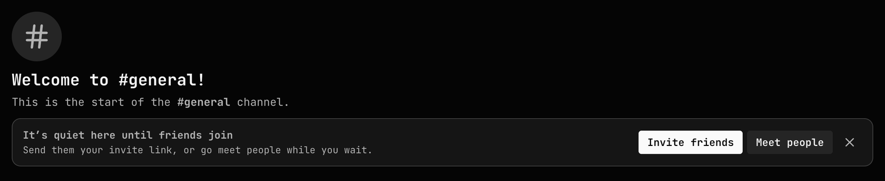

# Yapmod themes

A personal collection of themes for [Yapmod](https://github.com/ilyeshdz/yapmod).

## Black

Black pairs an ink-black channel view with graphite sidebars and white accents. Compact desktop channel rows use charcoal on hover and a brighter graphite fill for the current channel. Channel actions appear on hover or keyboard focus, and the composer gains a brighter edge when focused. Navigation feedback is immediate, with short panel and sheet transitions. JetBrains Mono runs throughout the interface. Server logos, avatars, emoji, and shared media keep their original colors.

### Install

1. [Download the collection](https://github.com/ilyeshdz/yapmod-theme/archive/refs/heads/main.zip) and unzip it.
2. Open **Settings → Themes → Import theme** in Yapmod and select the **themes/black** folder.
3. Switch on **Black** in the theme gallery.

### Theme source

Each directory under [themes/](themes/) is a standalone Yapmod theme package. For Black, [manifest.json](themes/black/manifest.json) declares its identity and dark mode, and [theme.css](themes/black/theme.css) defines the palette, font and control styles. The font loads from Google Fonts’ asset host, with a local monospace fallback.
